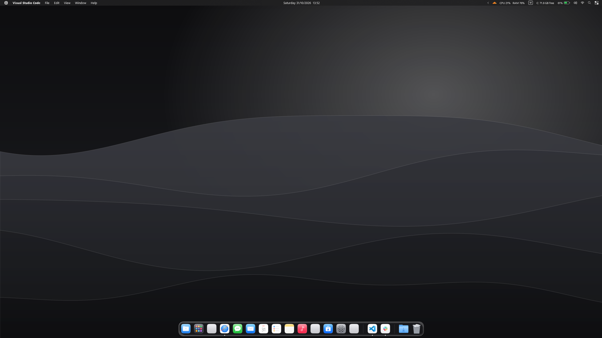
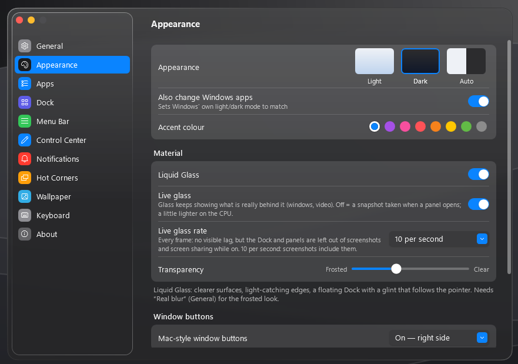
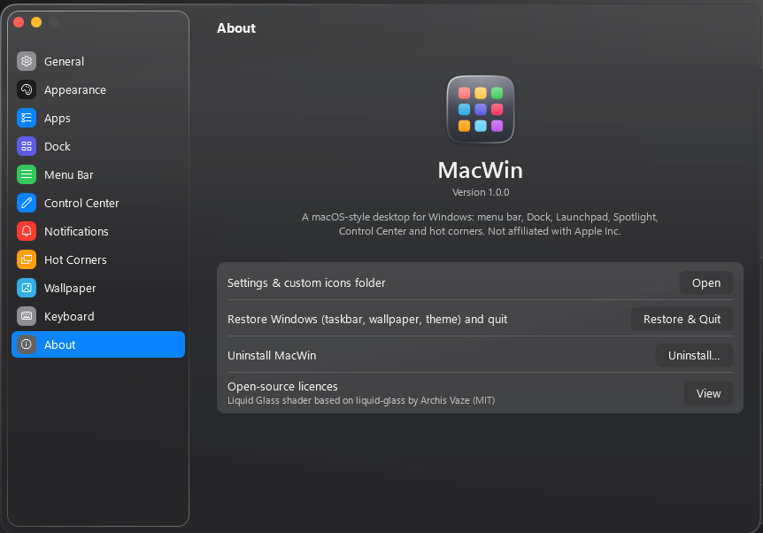

# MacWin — giao diện kiểu macOS cho Windows 10/11



<p align="center">
  
  
</p>

Một file `MacWin-Setup.exe` duy nhất: copy sang máy nào (Windows 10 2004+ / Windows 11, 64-bit) → nhấp đúp → làm theo trình cài đặt. Không cần quyền Admin, không cần cài .NET.

## Cài đặt trên máy khác

1. Tải `MacWin-Setup.exe` ở mục [Releases](https://github.com/Tamnemng/MacWin/releases) (hoặc tự build, xem bên dưới) và copy sang máy đích.
2. Nhấp đúp → trình cài đặt kiểu macOS: **Introduction → Options → Apps → Installation → Summary**.
   - Options: tự chạy khi đăng nhập, ẩn taskbar Windows, chạm phím Win mở Launchpad, hình nền, sáng/tối, blur, shortcut.
   - Apps: chọn app thật cho từng ô (Trình duyệt → Chrome / Edge / Cốc Cốc / Firefox…, Tin nhắn → Zalo / Messenger / Telegram…).
3. Bấm **Open MacWin**. Từ lần sau MacWin tự chạy ngay khi đăng nhập (tác vụ *Task Scheduler ▸ MacWin*, tiến trình `MacWin.exe`; không đi qua hàng đợi *Startup apps* của Explorer nên không phải chờ các app khởi động khác).

> Windows SmartScreen có thể cảnh báo vì file chưa ký số: bấm **More info ▸ Run anyway**.

Cài vào `%LocalAppData%\Programs\MacWin`, cài đặt lưu ở `%AppData%\MacWin`.

## Tính năng

| Thành phần | Chi tiết |
|---|---|
| **Menu Bar** | Thanh trên cùng trong mờ (blur thật), đăng ký AppBar nên cửa sổ phóng to không đè lên. Menu logo (About This PC, Force Quit, Sleep/Restart/Shut Down/Lock/Log Out), tên app đang dùng (in đậm), menu File/Edit/View/Window/Help **hoạt động thật** (gửi phím tắt tới app), rê chuột chuyển menu như macOS. Bên phải: pin, Wi-Fi, Spotlight, Control Center, đồng hồ. |
| **Dock** | Phóng to icon theo con trỏ (đường cong cos, neo dưới con trỏ), blur thật, chấm báo app đang chạy, icon nảy khi mở app, kéo để sắp xếp / kéo ra ngoài để gỡ, thả file vào app để mở, thả vào Thùng rác để xoá, ngăn Downloads dạng lưới, đặt trái/dưới/phải, app đang chạy hiện sau vạch ngăn. **Xem trước cửa sổ**: rê chuột lên icon có từ 2 cửa sổ trở lên → dải kính hiện ảnh thu nhỏ trực tiếp của từng cửa sổ, bấm để chuyển tới, × để đóng; dải trượt theo khi rê sang icon khác (tắt ở *Settings ▸ Dock*). **Ẩn thông minh** (mặc định bật): cửa sổ phóng to hoặc đè lên Dock → Dock trượt xuống, cửa sổ tràn tới đáy màn hình; đưa chuột sát mép dưới để hiện lại; không có gì che → Dock luôn hiện. |
| **Toàn màn hình** | Phim / game / F11: menu bar, Dock và taskbar đều ẩn; thoát toàn màn hình → hiện lại ngay. |
| **Ứng dụng kiểu Mac** | Mỗi ô Dock là một *vai trò* (Browser, Messages, Mail, Maps, Photos, Meet, Calendar, Reminders, Notes, Music, Code, Store, Settings…) với icon phong cách mac. Chọn app Windows chạy phía sau trong *Settings ▸ Apps* hoặc chuột phải ô Dock ▸ Options ▸ Open with. Đổi tên ô tuỳ ý. |
| **Launchpad** | Toàn màn hình, nền mờ, lưới 7×5, nhiều trang (lăn chuột / vuốt / phím mũi tên / chấm trang), ô tìm kiếm, hiệu ứng zoom khi mở/đóng, chuột phải: Add to Dock / Uninstall. Mở bằng **chạm phím Win**. |
| **Spotlight** | **Alt+Space**. Tìm app, file (Windows Search index), trang Settings, lệnh hệ thống (khoá máy, tắt máy, đổi sáng/tối…), máy tính (`12*3+5`), tìm web. Khung xem trước bên phải, ↑/↓, Enter mở, Ctrl+Enter mở thư mục chứa. |
| **Control Center** | Bật/tắt Wi-Fi & Bluetooth thật, độ sáng (laptop), âm lượng, Dark Mode, Focus, Screen Mirroring, Now Playing (điều khiển Spotify/YouTube/…). |
| **Thông báo** | Đọc thông báo của mọi app (Zalo, Outlook, Teams, Chrome…). **Banner kiểu Mac** trượt vào từ góc phải trên, xếp chồng, tự trượt ra sau vài giây (rê chuột vào thì giữ lại), bấm để mở app, vuốt sang phải để bỏ qua, nút × khi rê chuột. **Notification Center** mở khi bấm đồng hồ: gom theo app thành chồng (bấm để mở rộng / Show Less), Clear All, widget Lịch. Banner gốc của Windows được tắt để không hiện 2 lần, và bật lại khi thoát MacWin. **Do Not Disturb** ở nút Focus trong Control Center. |
| **Hot Corners** | 4 góc màn hình: Mission Control, Desktop, Launchpad, Spotlight, Notification Center, Control Center, Lock Screen. |
| **Liquid Glass** | (mặc định bật) Dock là tấm kính **khúc xạ thật** bằng shader GPU: ảnh nền phía sau bị bẻ cong ở mép như thấu kính, viền có chút tách màu, mép sáng theo hướng ánh sáng, đốm sáng chạy theo con trỏ. Khi có cửa sổ nằm sau, Dock tự chuyển sang kính mờ. Menu và panel mờ kính thật, viền bắt sáng, ánh bóng phía trên. Chỉnh độ trong ở *Settings ▸ Appearance ▸ Transparency*; tắt để về kiểu cổ điển. |
| **Bo góc** | Bo góc kiểu "liên tục" (độ cong tăng dần, không gãy như cung tròn) cho Dock, menu, Spotlight, Control Center, cửa sổ. Mép được khử răng cưa, kể cả khi có blur. |
| **Nút đỏ/vàng/xanh** | Trên thanh tiêu đề cửa sổ đang dùng của mọi app: đóng / thu nhỏ / phóng to thật, màu nền khớp thanh tiêu đề, chạy theo khi kéo cửa sổ. *Settings ▸ Appearance ▸ Window buttons*: Tắt / Bên phải (che nút ✕ □ – gốc) / Bên trái (vị trí kiểu Mac, có thể che tab đầu của trình duyệt). |
| **Giao diện** | Sáng / Tối / Tự động (đổi cả giao diện Windows), 8 màu nhấn, 6 hình nền gốc tạo bằng thuật toán có bản sáng/tối tự đổi, âm thanh khởi động, boot animation (tuỳ chọn). |
| **Cửa sổ của MacWin** | Nút đèn giao thông đỏ/vàng/xanh, bo góc, nền mờ. |

## Phím tắt

| Phím | Chức năng |
|---|---|
| Alt + Space | Spotlight |
| Chạm Win | Launchpad (Win+E, Win+L… vẫn hoạt động bình thường) |
| Ctrl + Alt + Space | Control Center |
| Alt + Q | Thoát app đang dùng |
| Win + Tab | Mission Control |

## Icon riêng

Bộ cài chỉ chứa icon do MacWin tự vẽ (không dùng icon/logo của Apple). Muốn dùng icon khác:
- *Settings ▸ Apps*: bấm vào icon của ô → chọn file `.png`/`.ico`, hoặc
- bỏ ảnh vào `%AppData%\MacWin\Icons\` đặt tên theo ô (`browser.png`, `mail.png`, `trash.png`, `trash-full.png`, `launchpad.png`…) hoặc theo tên app (`Google Chrome.png`).

## Nhẹ máy

- Khi không thao tác: CPU ≈ 0% (vòng lặp animation chỉ chạy khi có chuyển động; theo dõi cửa sổ bằng sự kiện của Windows thay vì quét liên tục).
- Launchpad / Spotlight / Control Center chỉ tạo khi mở lần đầu; độ sáng chỉ đọc khi mở Control Center.
- Blur do GPU (DWM) xử lý. Máy yếu: *Settings ▸ General ▸ Real blur* tắt, bật *Reduce motion*.

## Gỡ / khôi phục

- Thoát: menu logo ▸ **Quit MacWin** (taskbar Windows hiện lại ngay).
- Gỡ: *Windows Settings ▸ Apps ▸ Installed apps ▸ MacWin ▸ Uninstall* (tuỳ chọn khôi phục hình nền & theme gốc).
- Khẩn cấp: chạy `Khoi-phuc-Windows.cmd` hoặc `MacWin.exe --restore`.

## Build lại từ mã nguồn

Cần .NET 8 SDK:

```powershell
powershell -ExecutionPolicy Bypass -File build.ps1   # → dist\MacWin-Setup.exe
```

Cấu trúc: `MacWin\Native` (Win32 interop: AppBar, blur, hook phím, âm lượng, icon shell) · `MacWin\Services` (cài đặt, theme, danh mục app, vai trò app, icon, hình nền, trình cài đặt) · `MacWin\UI` (Menu Bar, Dock, Launchpad, Spotlight, Control Center, Settings, Setup) · `MacWin\Themes\Styles.xaml`.

## Giới hạn

- Không đổi được thanh tiêu đề / nút đóng của cửa sổ app khác (Windows không cho phép). Chỉ cửa sổ của MacWin có nút đèn giao thông.
- Hỗ trợ màn hình chính; màn hình phụ giữ nguyên.
- Khi taskbar bị ẩn, khay hệ thống (tray icons) không hiển thị. Mở bằng Win+B hoặc tắt *Hide the Windows taskbar*.
- Thông báo có nút bấm (cuộc gọi, báo thức, Snipping Tool) vẫn dùng banner Windows vì nút chỉ hoạt động ở đó. Bấm banner MacWin sẽ mở app chứ không mở đúng tin nhắn cụ thể.
- MacWin không liên quan tới Apple Inc.; "macOS" chỉ dùng để mô tả phong cách.

## Mã nguồn bên thứ ba

Shader Liquid Glass (`MacWin/UI/LiquidGlassEffect.cs`) được chuyển từ GLSL sang HLSL dựa trên [liquid-glass](https://github.com/archisvaze/liquid-glass) của Archis Vaze — MIT License, Copyright (c) 2026 Archis Vaze. Toàn văn giấy phép nằm trong đầu file shader.
